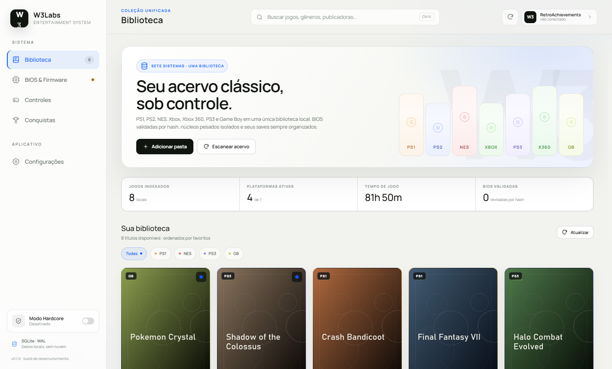
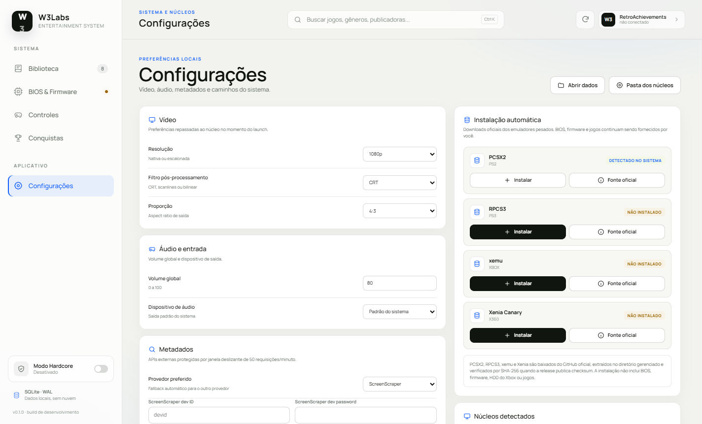
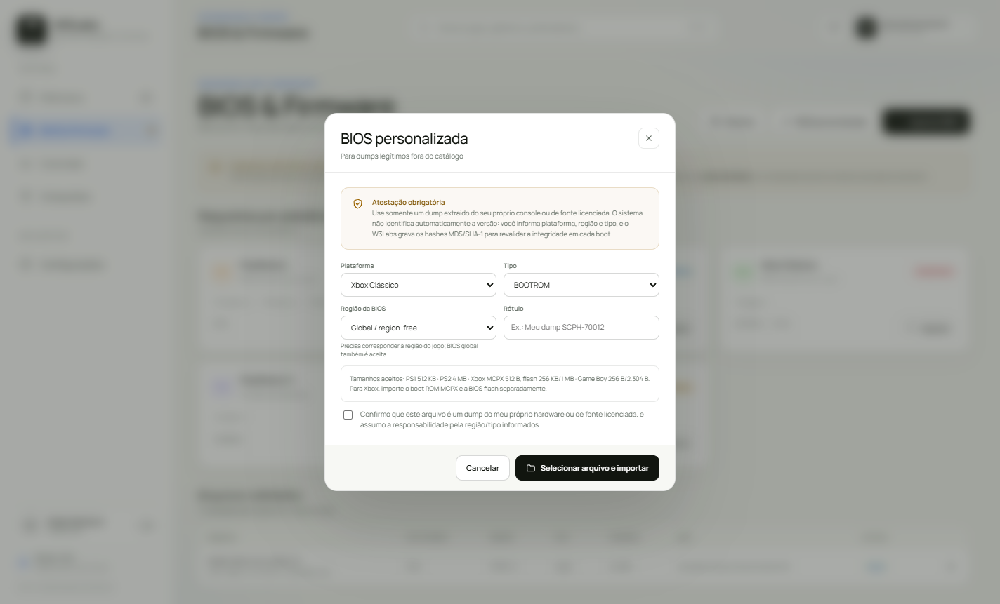

# W3Labs Entertainment System

Emulador multi-console com interface unificada para **PlayStation, PlayStation 2, NES, Xbox Clássico, Xbox 360, PlayStation 3 e Game Boy / Game Boy Color**. Este repositório entrega a **Fase 1**: arquitetura executável, orquestração segura de núcleos, biblioteca, BIOS, save states, controles, RetroAchievements, IPC, instalador automático de emuladores e uma interface clara com tipografia Nokia Pure Headline quando licenciada.

> **Conteúdo legal:** o projeto não fornece, hospeda, baixa ou indica links de ROMs, ISOs ou BIOS. Todos os arquivos protegidos devem ser obtidos e importados pelo próprio usuário, a partir do seu hardware ou de fonte licenciada. O catálogo contém apenas hashes (fingerprints), nunca o conteúdo das BIOS.

## Stack

| Camada        | Implementação                                                                    |
| ------------- | -------------------------------------------------------------------------------- |
| Frontend      | Electron 45, HTML5, CSS3, Vanilla JS; tema claro, Manrope + Nokia Pure local    |
| Instaladores  | Releases oficiais do GitHub: PCSX2, RPCS3, xemu e Xenia                          |
| Backend       | Node.js/JavaScript no processo principal, `child_process.fork` para núcleos      |
| IPC           | `ipcMain.handle` + `contextBridge`, 100% assíncrono, sem `nodeIntegration`       |
| Banco         | SQLite nativo do Node 24 (`node:sqlite`), `PRAGMA journal_mode = WAL`            |
| Segurança     | `sandbox: true`, `contextIsolation: true`, CSP, validação de sender, AES-256-GCM |
| Empacotamento | electron-builder (NSIS / DMG / AppImage); NSIS x64 medido em **115,7 MB**        |

Sem dependências nativas de banco: o Electron 45 embarca Node 24 com `node:sqlite`. Isso elimina rebuild de ABI no install.

## Início rápido

```powershell
npm install
npm test
npm start
```

Requisitos: Node.js 22.13+ (recomendado 24), Windows 10/11, macOS 12+ ou Linux. O app inicia vazio; importe uma pasta de jogos e depois as BIOS exigidas.



> Captura feita com uma biblioteca sintética de demonstração. Nenhuma capa, ROM ou BIOS real é distribuída no repositório.

### Tipografia

A interface tenta **Nokia Pure Headline** via `local()`; se a fonte licenciada não estiver instalada no sistema, usa **Manrope** (OFL) empacotada em `src/renderer/assets/fonts/`. A Nokia Pure é proprietária e não é redistribuída. Veja [docs/FONTS.md](docs/FONTS.md).

```powershell
npm run verify        # checa Node, node:sqlite, arquivos e catálogo
npm run lint          # ESLint
npm run format:check  # Prettier
npm run dist          # instalador
```

Em desenvolvimento, os dados ficam em `./data` e os save states em `./saves`. Em produção, tudo fica sob `app.getPath('userData')`. Defina `W3_DATA_DIR` para um caminho portátil.

## Árvore do projeto

```text
W3Labs-Entertainment-System/
├─ config/
│  ├─ platforms.js              # fonte de verdade: extensões, BIOS, isolamento
│  ├─ bios-catalog.json         # hashes conhecidos (somente fingerprints)
│  └─ cores.example.json        # template de configuração dos núcleos
├─ docs/
│  ├─ ARCHITECTURE.md
│  ├─ DATABASE.md
│  ├─ CORE-INTEGRATION.md
│  └─ FONTS.md
├─ scripts/
│  └─ verify.js                 # pré-requisitos e arquivos essenciais
├─ src/
│  ├─ main/
│  │  ├─ main.js                # ciclo Electron, janela, protocolo de capa
│  │  ├─ config.js              # defaults, caminhos, limites
│  │  ├─ ipc.js                 # contrato IPC + validação de origem
│  │  ├─ cores/
│  │  │  ├─ core-host.js        # processo filho; nunca carrega ROM na RAM
│  │  │  ├─ core-manager.js     # fork, request/response, shutdown
│  │  │  ├─ core-registry.js    # descoberta de binários + launch spec
│  │  │  └─ emulator-installer.js # releases oficiais + SHA-256 + tar
│  │  ├─ db/
│  │  │  ├─ database.js         # SQLite WAL, migrações, statements
│  │  │  └─ migrations/          # 001_initial + 002_custom_bios
│  │  ├─ lib/
│  │  │  ├─ hash.js             # SHA-1/MD5 em streaming
│  │  │  ├─ rate-limiter.js     # 50 req/min, janela deslizante
│  │  │  ├─ crypto-vault.js     # AES-256-GCM
│  │  │  ├─ logger.js           # logs .txt + SQLite
│  │  │  ├─ paths.js            # isolamento de caminhos e save states
│  │  │  └─ errors.js
│  │  └─ services/
│  │     ├─ library-service.js
│  │     ├─ media-loader.js       # ROM/ISO sob demanda, só header na RAM
│  │     ├─ iso-detector.js       # desambigua .iso por conteúdo/pasta
│  │     ├─ bios-service.js
│  │     ├─ bios-catalog.js
│  │     ├─ metadata-service.js
│  │     ├─ save-state-service.js
│  │     ├─ retroachievements-service.js
│  │     ├─ controller-service.js
│  │     ├─ hardware-service.js
│  │     ├─ emulation-service.js
│  │     └─ settings-service.js
│  ├─ preload/
│  │  └─ preload.js             # API mínima exposta ao renderer
│  └─ renderer/
│     ├─ index.html
│     ├─ styles.css
│     ├─ theme.css               # tema claro + tipografia
│     ├─ assets/fonts/           # Manrope (OFL) e instruções de fonte Nokia
│     └─ app.js
├─ tests/
│  ├─ fixtures/fake-bridge.js
│  ├─ core-manager.test.js
│  ├─ database.test.js
│  ├─ bios.test.js
│  ├─ library.test.js
│  ├─ save-state.test.js
│  ├─ controllers.test.js
│  ├─ retroachievements.test.js
│  └─ hash-rate.test.js
├─ package.json
├─ eslint.config.js
└─ .env.example
```

## Requisitos cobertos

| Regra                            | Implementação                                                                                        |
| -------------------------------- | ---------------------------------------------------------------------------------------------------- |
| RF01–RF04 (PS1, PS2, NES, Xbox)  | Extensões + detecção de ISO por conteúdo/pasta/tamanho; plataforma ajustável no detalhe.             |
| RF05–RF06 (BIOS)                 | Catálogo automático **ou BIOS personalizada com atestação**, MD5 + SHA-1 e revalidação por boot.     |
| RF07–RF08 (biblioteca/metadados) | Scan recursivo, hashes em streaming, ScreenScraper/IGDB, cache e rate limit de 50 req/min.           |
| RF09–RF10 (save/load state)      | Slots 0–99, caminho canônico, bridge de núcleo.                                                      |
| RF11–RF12 (controles)            | Perfis P1–P4, XInput/DirectInput/teclado, validação estrita de GUID.                                 |
| RF17–RF18 (histórico/playtime)   | `play_sessions` + `games.playtime_seconds`, tick somente quando ativo e não pausado.                 |
| RF20 (pausar/retomar)            | API IPC e UI; depende da capability do bridge.                                                       |
| RF21 (RetroAchievements)         | API key cifrada, perfil, vínculo de jogo, sincronização de conquistas, Hardcore.                     |
| RNF04 (IPC)                      | Todo o contrato em `ipcMain.handle`; preload expõe somente métodos nomeados.                         |
| RNF06 (consulta 1000 jogos)      | Índices + prepared statements; teste dedicado abaixo de 100 ms.                                      |
| RNF10 (segredos)                 | AES-256-GCM com chave local; nunca texto puro no SQLite.                                             |
| RNF13 (logs)                     | `.txt` diário + tabela `logs`.                                                                       |
| RNF14 (isolamento)               | PS2, Xbox e PS3 sempre em processo filho; PS1/NES/GB também isolados.                                |
| RNF16 (WAL)                      | `journal_mode=WAL`, `synchronous=NORMAL`, `busy_timeout=5000`.                                       |
| RNF17 (>2 GB)                    | Hash por stream com progresso em bytes; `MediaLoader` usa `stat` + header e o núcleo abre o arquivo. |
| RD01 (BIOS por região)           | Resolução por plataforma/região; região desconhecida bloqueia PS1/PS2/Xbox.                          |
| RD02 (copyright)                 | Nenhum link/download de ROM/BIOS; apenas importação local.                                           |
| RD03 (playtime)                  | Incremento a cada 15 s somente em sessão não pausada.                                                |
| RD04 (save path)                 | `./saves/[Plataforma]/[SHA1]/[Slot].state` aplicado por `AppPaths`.                                  |
| RD05 (GUID)                      | `ControllerService` recusa GUID ausente/malformado; UI não vincula dispositivo sem GUID.             |
| RD06 (rate limit)                | `RateLimiter` (50/60 s, 1,2 s entre chamadas) compartilhado por scraping e capas.                    |
| RD07 (deletar jogo)              | Remove apenas a linha do SQLite; arquivo físico preservado.                                          |
| RD08 (Hardcore)                  | `SaveStateService` verifica o estado a cada operação; ativação invalida save em andamento.           |
| RD09 (hardware)                  | `HardwareService.assess`; aviso bloqueante apenas para confirmação, nunca impede definitivamente.    |
| RD10 (boot BIOS)                 | 10 s de boot guard para PS1/PS2/Xbox; save/load recusados.                                           |

## Núcleos e Save States

O repositório **não inclui** binários de emuladores. Na primeira execução, o app cria `data/cores.json`; a descoberta também procura caminhos padrão e variáveis `W3_CORE_*`.

Para PS2, PS3, Xbox Clássico e Xbox 360, abra **Configurações → Instalação automática** e clique em **Instalar**. O W3Labs baixa a release oficial do GitHub, extrai no diretório gerenciado e valida SHA-256 quando a release publica checksum. O `CoreRegistry` reconhece a instalação imediatamente, sem reiniciar.

| Console | Emulador | Fonte oficial |
| --- | --- | --- |
| PS2 | PCSX2 | [pcsx2.net/downloads](https://pcsx2.net/downloads/) · [GitHub releases](https://github.com/PCSX2/pcsx2/releases) |
| PS3 | RPCS3 | [rpcs3.net/download](https://rpcs3.net/download) · [GitHub binaries](https://github.com/RPCS3/rpcs3-binaries-win/releases) |
| Xbox Clássico | xemu | [xemu.app/download](https://xemu.app/download/) · [GitHub releases](https://github.com/xemu-project/xemu/releases) |
| Xbox 360 | Xenia Canary | [xenia.jp/download](https://xenia.jp/download/) · [GitHub releases](https://github.com/xenia-canary/xenia-canary/releases) |

PS1, NES e Game Boy continuam com descoberta manual/configuração em `cores.json` (DuckStation, Mesen e SameBoy), pois são leves e não fazem parte do fluxo de download obrigatório. A instalação automática não baixa BIOS, firmware, HDD do Xbox ou jogos.



Núcleos externos abrem o jogo, mas não expõem comandos de estado. Para Save/Load State gerenciável, configure um **bridge JSON Lines** no campo `bridgeCommand` do núcleo. O contrato está em [`docs/CORE-INTEGRATION.md`](docs/CORE-INTEGRATION.md). O teste `tests/core-manager.test.js` exercita o caminho completo com um bridge de referência.

## Arquivos maiores que 2 GB

ISOs de PS2/Xbox/PS3 são lidas integralmente apenas pelo hash de streaming, em blocos de 1 MiB, com progresso em bytes na dock de escaneamento. O launch não carrega a mídia na RAM: valida `stat` + cabeçalho e passa o caminho ao núcleo. Para uma ISO de 4,7 GB, aguarde o hash terminar no primeiro escaneamento; escaneamentos seguintes reutilizam o registro se tamanho/mtime não mudarem. A verificação de BIOS ocorre antes do aviso de hardware, então pendências de BIOS aparecem primeiro.

A extensão `.iso` é compartilhada por PS1/PS2/PS3/Xbox. O scanner desambigua pelo conteúdo do ISO (`PS3_DISC.SFB`, `XBOX_DVD`, `BOOT2`), por dicas de pasta e, para imagens sem marcador acima de 1,5 GB, assume PS2. Se a plataforma ainda ficar errada, abra o jogo e altere **Plataforma** no detalhe; o próximo escaneamento mantém a correção.

### Diagnóstico de GPU

O Windows pode listar **Microsoft Basic Render Driver** ao lado da GPU real. O W3Labs agora ignora esse fallback quando existe uma GPU AMD/NVIDIA/Intel identificada. No seu caso, o diagnóstico real é `AMD Radeon RX590 GME`, 15,9 GB de RAM — portanto o aviso de hardware não deve mais aparecer.

## BIOS

`config/bios-catalog.json` contém hashes públicos de BIOS conhecidas. Para uma BIOS legítima ainda não catalogada, use **BIOS personalizada** na tela de BIOS: escolha plataforma, região, tipo e rótulo, confirme a atestação e selecione o arquivo. O sistema calcula MD5/SHA-1, valida o tamanho esperado para a plataforma e grava o fingerprint local. Antes de cada boot, o hash é recalculado; se o arquivo mudar, o boot é bloqueado.



Tamanhos aceitos no fluxo personalizado:

```text
PS1 BIOS        512 KB
PS2 BIOS          4 MB
Xbox MCPX       512 B
Xbox flash      256 KB ou 1 MB
Game Boy        256 B ou 2.304 B
PS3 firmware    até 512 MB (opcional)
```

Também é possível registrar fingerprints manualmente em `data/bios-catalog.custom.json`; o arquivo é validado por schema. O sistema nunca aceita uma BIOS apenas pelo nome.

```json
{
  "entries": [
    {
      "platform": "xbox",
      "region": "global",
      "kind": "flash",
      "label": "Meu dump verificado",
      "size": 262144,
      "md5": "…32 hex…",
      "sha1": "…40 hex…"
    }
  ]
}
```

## Testes

```text
32 testes, 32 aprovados
├─ SQLite WAL + consulta de 1.000 jogos < 100 ms
├─ hash SHA-1/MD5 em streaming com progresso em bytes
├─ rate limit de APIs
├─ BIOS catalogada, personalizada, inválida e adulterada
├─ GPU AMD + fallback Microsoft Basic Render sem falso positivo
├─ detecção PS2/PS3/Xbox/Xbox 360 por conteúdo de ISO
├─ seleção de assets oficiais e proteção contra archive traversal
├─ instalação automática real de Xenia e RPCS3 em diretório gerenciado
├─ scanner, região, reclassificação, deduplicação .bin/.cue e remoção sem apagar ROM
├─ isolamento de núcleo + bridge Save State
├─ MediaLoader ROM/ISO sem buffer integral
├─ GUID de controle
├─ AES-256-GCM + Hardcore / boot guard
└─ RetroAchievements online/offline
```

## Limites atuais (Fase 1)

- Os binários dos emuladores e as BIOS **não** acompanham o projeto.
- Save/Load State e pausa remota dependem de um bridge de núcleo. Sem ele, a UI informa explicitamente a indisponibilidade.
- O tracker de conquistas em tempo real exige integração nativa (rcheevos/memory watcher); a conta, o vínculo e a trava Hardcore já são reais.
- O Chromium não expõe GUID de DirectInput; a UI aceita apenas GUID reportado por um provider nativo. Perfis de teclado funcionam sem GUID.
- O instalador NSIS x64 foi medido em 115,7 MB (limite de 300 MB). Builds macOS/Linux ainda precisam de validação em CI.

## Documentação

- [Arquitetura e fluxos IPC](docs/ARCHITECTURE.md)
- [Modelagem do banco](docs/DATABASE.md)
- [Contrato de integração dos núcleos](docs/CORE-INTEGRATION.md)
